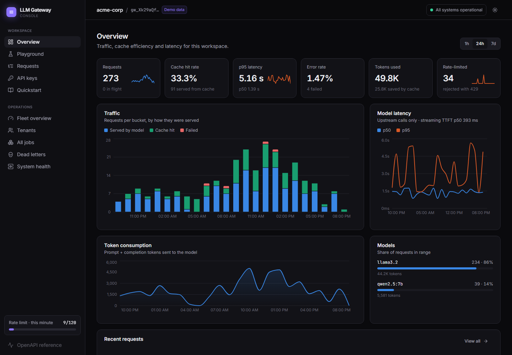
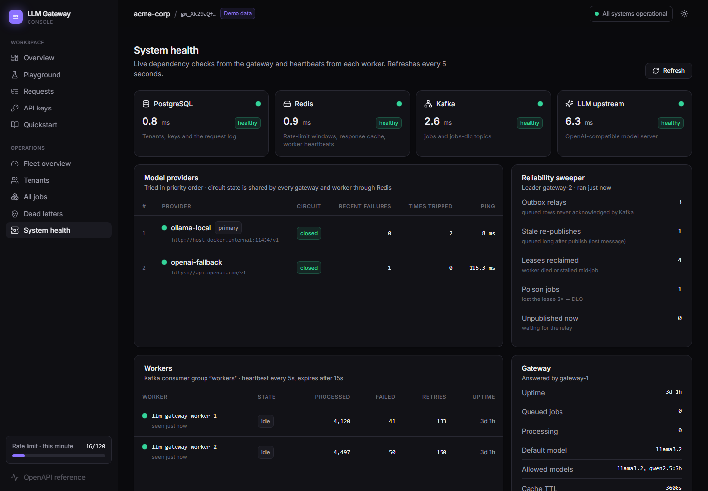
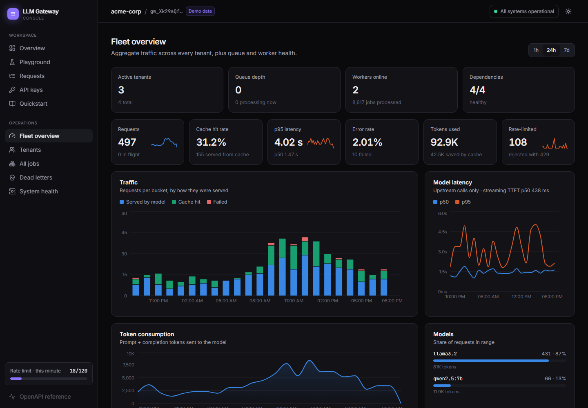
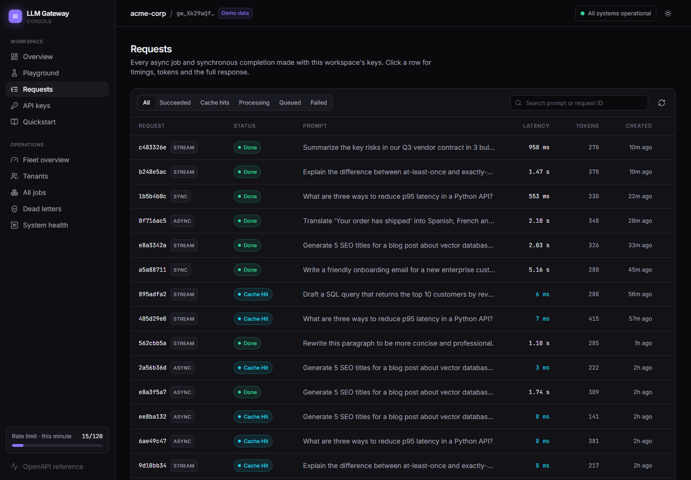
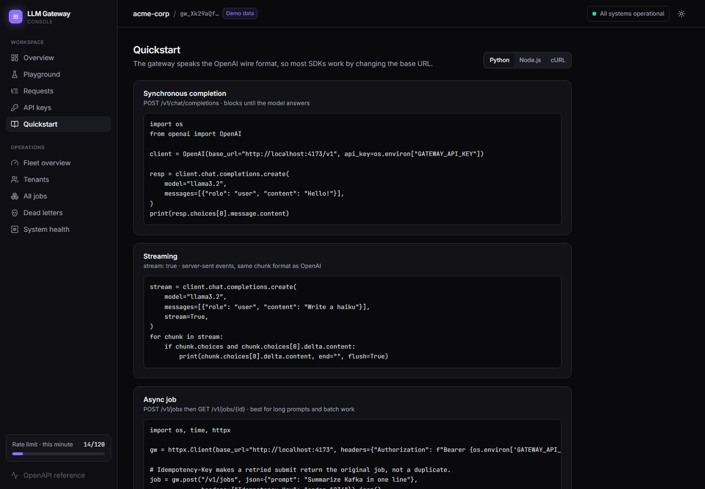
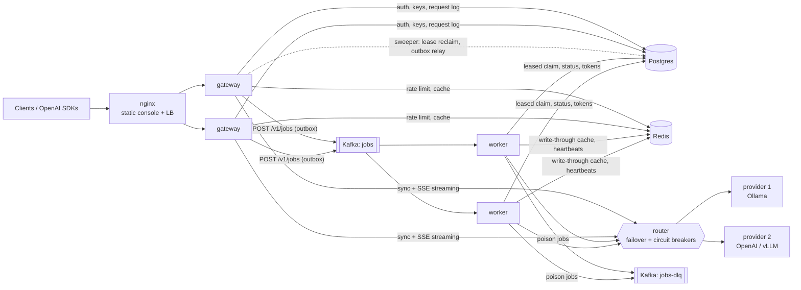

# LLM Gateway

A multi-tenant gateway that sits in front of any OpenAI-compatible model server and adds
the things every team ends up rebuilding: **API keys, per-tenant rate limits, a response
cache, a fault-tolerant async job queue, multi-provider failover, streaming, and
observability**, with a web console for both tenants and operators.

**[▶ Live demo](https://rishitha744.github.io/llm-gateway/)**: the full console running on a
simulated backend in your browser. No sign-up needed.

[](https://github.com/Rishitha744/llm-gateway/actions/workflows/ci.yml)




<table>
  <tr>
    <td><br/><sub><b>System health</b>: dependency checks, provider circuit breakers, sweeper stats and worker heartbeats</sub></td>
    <td><br/><sub><b>Fleet overview</b>: traffic, cache hit rate, latency and quotas across every tenant</sub></td>
  </tr>
  <tr>
    <td><br/><sub><b>Requests</b>: every async job, sync call and stream, with timings and tokens</sub></td>
    <td><br/><sub><b>Quickstart</b>: drop-in OpenAI SDK examples, streaming and idempotent jobs</sub></td>
  </tr>
</table>

### Try it in 60 seconds

Open the **[live demo](https://rishitha744.github.io/llm-gateway/)** and:

1. **Playground → Async job → Send request.** Watch the job move Accepted → Queued → Processing → Completed.
2. **Send the same prompt again.** It's served instantly from the cache (`x-cache: HIT`).
3. **Switch to Sync (OpenAI) with "Stream tokens" on.** Text streams in word by word, with time to first token shown.
4. **Click "Retry with same key"** (async mode). The `Idempotency-Key` returns the original job instead of a duplicate.
5. **Click "Burst test".** Requests past the per-minute quota are rejected with `429`.
6. **Open System health.** See provider circuit breakers, the reliability sweeper and worker heartbeats.

> The hosted demo runs on an in-browser mock of the API, which mirrors every endpoint's real
> request and response shape. Run the full stack locally with Docker (below) to use real
> models through Ollama.

## Architecture



**Request path.** nginx load-balances across gateway replicas. The gateway resolves the
bearer key (stored as a SHA-256 hash) to a tenant, then applies a Redis fixed-window rate
limit. Sync calls check the tenant-scoped cache and otherwise go through the provider router,
either as one JSON response or as server-sent events (`stream: true`). Async calls either
return a cache hit immediately or write a `queued` row to Postgres and then publish the job ID
to Kafka, keyed by tenant. The row is the outbox, so a failed publish is retried later
rather than lost.

**Provider routing.** Providers are tried in priority order. Provider-side failures (timeouts,
429, 5xx) count against a per-provider circuit breaker whose state lives in Redis, so every
gateway and worker shares it. They then fail over to the next provider. Client errors (other
4xx) never fail over. A stream can only fail over before its first token.

**Worker path.** A worker claims a job by atomically moving it `queued → processing`. The
claim stamps a random claim token and a lease deadline, and a keeper task renews the lease
while the model call runs. Every later write is fenced on the token, so a worker that lost
its lease can't overwrite the new owner. Transient failures are retried with exponential
backoff plus jitter. Exhausted retries and fatal errors mark the job `failed` and publish it
to `jobs-dlq`. Successful answers are written through to the cache.

**Sweeper.** One gateway replica at a time (Postgres advisory lock) does three things:
- re-queues jobs whose lease expired (the worker crashed)
- dead-letters jobs that lost their lease `MAX_CLAIMS` times (poison)
- relays outbox rows Kafka never acknowledged, plus jobs left queued long after
  publication (a lost message)

It publishes only after its state change commits; publishing earlier lets a fast worker
read the old row and skip the job.

## Features

| | |
|---|---|
| **Multi-tenancy** | Tenants, multiple named keys per tenant, rotation & revocation, suspension |
| **Rate limiting** | Per-tenant requests/minute with `X-RateLimit-*` and `Retry-After` headers |
| **Response cache** | Keyed by tenant + model + params + messages; reports tokens saved |
| **Async jobs** | Kafka-backed, tenant-partitioned, leased + fenced workers, retries, DLQ, operator retry |
| **Reliability** | Transactional outbox, lease reclaim for crashed workers, poison-job detection, `Idempotency-Key` for safe client retries |
| **Multi-provider** | Priority failover across OpenAI-compatible providers, logical→provider model mapping, Redis-shared circuit breakers |
| **OpenAI-compatible** | `POST /v1/chat/completions` (incl. `stream: true` SSE with time-to-first-token tracking) and `GET /v1/models` work with the official SDKs |
| **Observability** | Request log in Postgres; p50/p95 latency, cache hit rate, error rate, tokens, 429s; readiness checks; worker heartbeats; `X-Request-ID` and JSON access logs |
| **Console** | Tenant workspace (overview, playground, requests, keys, quickstart) and operator console (fleet, tenants, all jobs, dead letters, system health) |
| **Demo mode** | The console ships an in-browser simulated backend, so it can be hosted statically as a live demo |

## Quick start

Requirements: Docker, plus an OpenAI-compatible model server. The defaults expect
[Ollama](https://ollama.com) on the host with `ollama pull llama3.2`.

```bash
cp .env.example .env          # then set ADMIN_TOKEN to a long random value
docker compose up -d --build  # 2 gateways, 2 workers, nginx, postgres, redis, kafka
python scripts/create_tenant.py acme-corp --rate-limit 120
```

Open **http://localhost:8080**, sign in with the printed API key, and use
**Connect operator console** in the sidebar to add your `ADMIN_TOKEN`. To fill the
dashboards:

```bash
python scripts/load_test.py --key gw_... --requests 80 --concurrency 8
```

Interactive API docs live at **http://localhost:8080/docs**.

### Console development

```bash
cd web && npm install
npm run dev          # http://localhost:5173, proxies API calls to :8080
npm run build:demo   # static build with the simulated backend (web/dist)
```

Pushing to `main` publishes the demo build to GitHub Pages via `.github/workflows/demo.yml`
(enable Pages with source "GitHub Actions").

## API

All tenant endpoints take `Authorization: Bearer <api key>`. Admin endpoints take
`X-Admin-Token`.

| Method | Path | Purpose |
|---|---|---|
| `POST` | `/v1/chat/completions` | OpenAI-compatible completion; `stream: true` for SSE |
| `POST` | `/v1/jobs` | Queue a prompt (`202`), or `200` on a cache hit or `Idempotency-Key` replay |
| `GET` | `/v1/jobs`, `/v1/jobs/{id}` | List (filter, search, cursor pagination) or inspect jobs |
| `GET` | `/v1/usage?range=1h\|24h\|7d` | Time series and summary for the tenant |
| `GET/POST/DELETE` | `/v1/keys` | Self-service key management |
| `GET` | `/v1/me`, `/v1/models` | Tenant identity, quota, defaults; allowed models |
| `GET` | `/admin/overview` | Fleet-wide usage, per-tenant volume, queue depth |
| `GET/POST/PATCH` | `/admin/tenants[/{id}]` | Create tenants (returns first key), change quota, suspend |
| `POST/DELETE` | `/admin/tenants/{id}/keys`, `/admin/keys/{id}` | Issue and revoke keys |
| `GET` | `/admin/jobs` | Cross-tenant job log |
| `POST` | `/admin/jobs/{id}/retry` | Re-queue a dead-lettered job |
| `GET` | `/admin/system` | Dependency checks, worker fleet, config |
| `GET` | `/health`, `/health/ready` | Liveness; readiness (Postgres, Redis, Kafka) |

## Configuration

| Variable | Default | |
|---|---|---|
| `LLM_BASE_URL` / `LLM_API_KEY` / `LLM_MODEL` | Ollama / `llama3.2` | Single upstream and default model |
| `LLM_PROVIDERS` | – | JSON list of providers for failover (see `.env.example`); overrides `LLM_BASE_URL` |
| `CB_THRESHOLD` / `CB_COOLDOWN_S` | `5` / `30` | Failures before a provider's circuit opens; how long it stays open |
| `LEASE_S` | `30` | Worker lease length (renewed every `LEASE_S/3`); bounds crash-detection time |
| `MAX_CLAIMS` | `3` | Lease losses before a job is dead-lettered as poison |
| `STALE_QUEUED_S` | `300` | Re-publish jobs still queued this long after publication |
| `ALLOWED_MODELS` | `LLM_MODEL` | Comma-separated models tenants may request |
| `ADMIN_TOKEN` | – | Enables the admin API and operator console |
| `CACHE_TTL_S` | `3600` | Response cache lifetime |
| `GATEWAY_REPLICAS` / `WORKER_REPLICAS` | `2` / `2` | Horizontal scale |
| `DEFAULT_MAX_TOKENS` / `MAX_TOKENS_CAP` | `300` / `2048` | Generation limits |

## Design notes

- **Postgres is the source of truth for jobs**; Kafka only carries job IDs. Status reads,
  analytics and the DLQ view are SQL, and a lost Redis never loses a job.
- **Effectively-once processing on at-least-once delivery.** Three pieces make this work
  without Kafka transactions:
  - the conditional `queued → processing` claim
  - a lease with a fencing token
  - the sweeper's outbox relay

  Duplicate messages are harmless, and every way a job could be lost has a recovery path.
- **Failure modes covered** (each was reproduced against the running stack):

  | Failure | What happens |
  |---|---|
  | Worker killed mid-job | The lease expires, the sweeper re-queues the job, and another worker finishes it |
  | Kafka down at submit | The API still answers `202`, the row waits unpublished, and the relay publishes it once Kafka recovers |
  | Model call longer than the lease | The keeper renews the lease, so the job isn't stolen |
  | Primary provider down | Requests fail over to the next provider, and its circuit opens after `CB_THRESHOLD` failures |
  | Client retries a submit | Same `Idempotency-Key` returns the original job; a different body with the same key gets `422` |
- **Tenant-keyed partitions** preserve per-tenant ordering. The topic has 6 partitions,
  so workers scale out up to that count.
- **Schema migrations** run at gateway startup under a Postgres advisory lock, so replicas
  can boot concurrently.
- **Rate-limit rejections** never reach Postgres. They are counted in 5-minute Redis slots
  so the charts can still show them.

## Tests

```bash
pip install -r tests/requirements.txt && pytest -q
```

These are unit tests for the circuit breaker (open, half-open probe, re-trip) and the router
(failover, open-circuit skip, fatal 4xx, model mapping, streaming failover before the first
token), with mocked HTTP providers and fake Redis. CI also builds every image and the console.

## Project layout

```
common/    Shared by gateway + workers: provider router, circuit breaker, cache keys
gateway/   FastAPI service: auth, rate limiting, cache, sync + async API, admin API, sweeper
worker/    Kafka consumer: retries, DLQ, cache write-through, heartbeats
web/       React + TypeScript console (Vite, Tailwind, TanStack Query, Recharts)
nginx/     Edge config: static console + load-balanced API
scripts/   create_tenant.py, load_test.py
tests/     pytest suite for routing and circuit breaking
```
